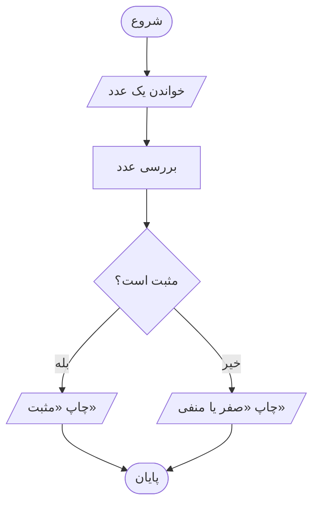
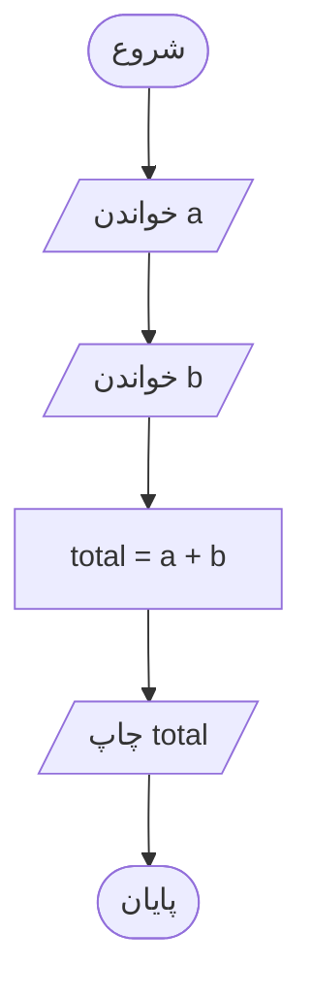
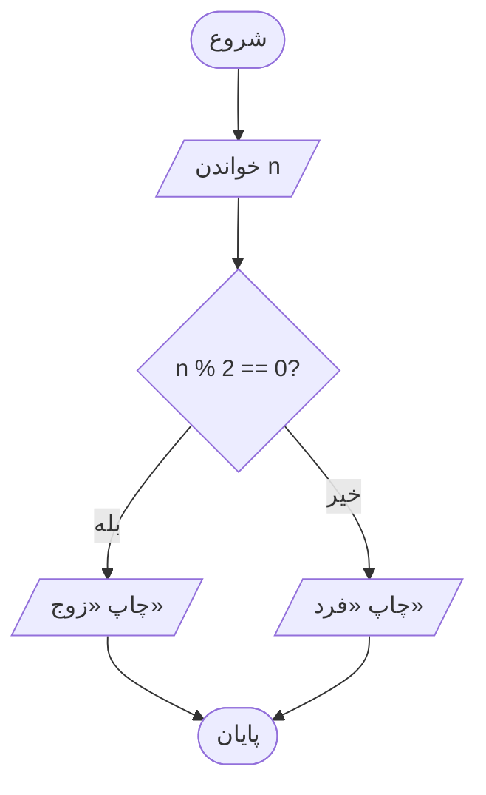
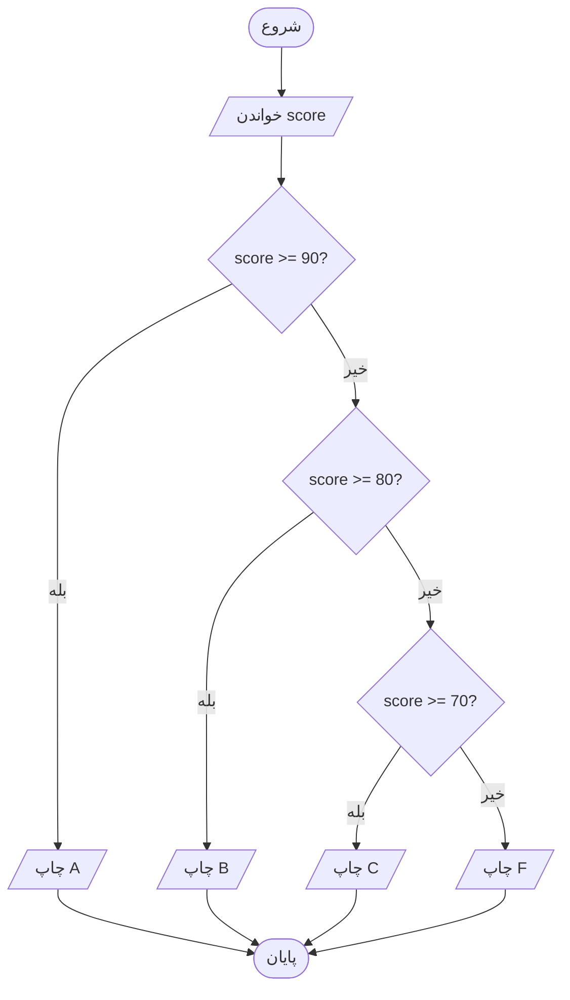
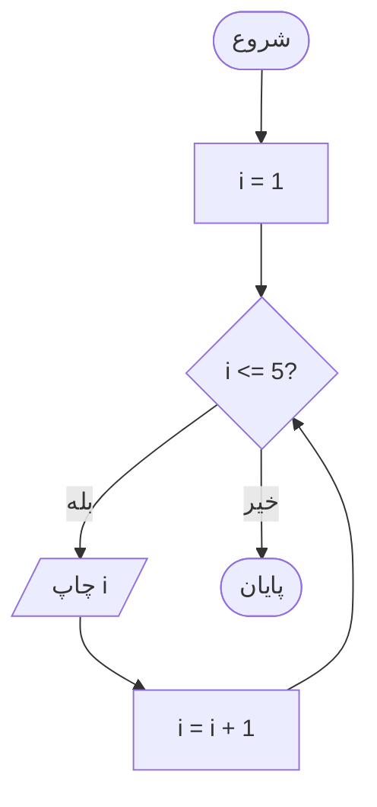
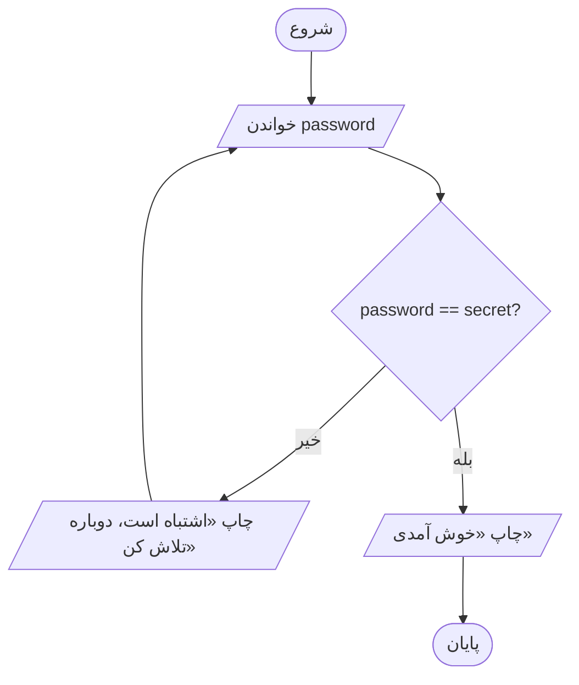
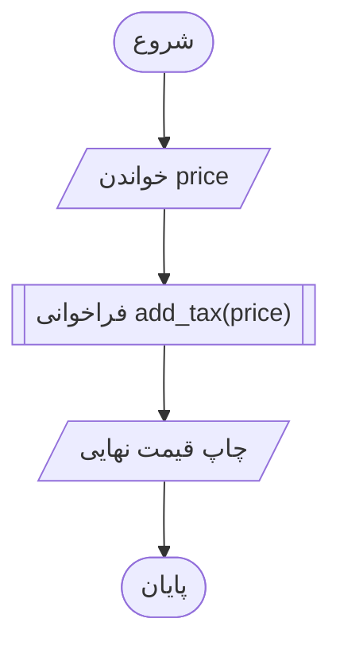
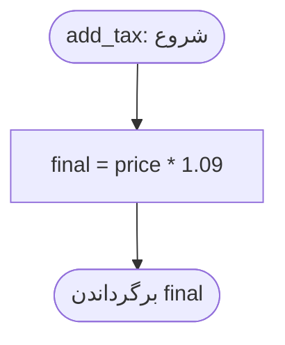
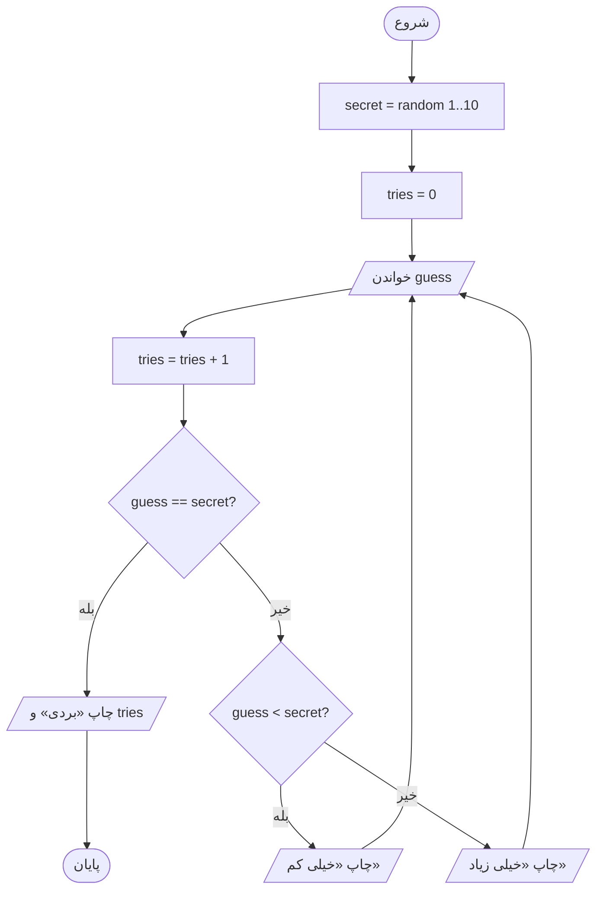
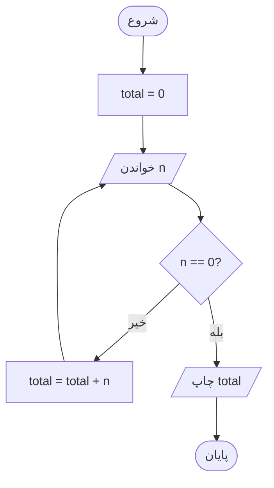

# آموزش آسان فلوچارت‌ها (با پایتون)

> یک ماژول آموزشی کامل و عملی دربارهٔ برنامه‌ریزی برنامه‌ها با فلوچارت: نمادها، دنباله، تصمیم، حلقه و تابع؛ و ترجمهٔ گام‌به‌گامِ هر کدام به کد پایتونِ اجرایی.

**سطح:** کاملاً مبتدی ← مقدماتیِ رو به متوسط
**پیش‌نیازها:** پایتون 3.10 یا بالاتر (مثال‌ها از f-string و نحو جدید استفاده می‌کنند). اختیاری: کتابخانهٔ `graphviz` برای فصل جایزه.
**زمان تخمینی:** ۴ تا ۶ ساعت (مطالعه + تمرین + حل مسئله)

---

## فهرست مطالب

1. [فلوچارت چیست؟](#1-فلوچارت-چیست)
2. [نمادهایی که لازم دارید](#2-نمادهایی-که-لازم-دارید)
3. [چگونه در این سند فلوچارت می‌کشیم](#3-چگونه-در-این-سند-فلوچارت-میکشیم)
4. [بلوک ۱: دنباله](#4-بلوک-1-دنباله-گامبهگام)
5. [بلوک ۲: تصمیم (`if / else`)](#5-بلوک-2-تصمیم-if--else)
6. [بلوک ۳: حلقه‌ها](#6-بلوک-3-حلقهها-تکرار)
7. [بلوک ۴: توابع](#7-بلوک-4-توابع-دستور-پختهای-قابل-استفادهٔ-دوباره)
8. [روش ۵ گامی: از مسئله تا کد](#8-روش-5-گامی-از-مسئله-تا-کد)
9. [مثال کامل: بازی حدس عدد](#9-مثال-کامل-بازی-حدس-عدد)
10. [جایزه: ساختن فلوچارت با پایتون](#10-جایزه-ساختن-فلوچارت-با-پایتون)
11. [اشتباه‌های رایج](#11-اشتباههای-رایج)
12. [تمرین‌ها](#12-تمرینها)
13. [مرجع سریع](#13-مرجع-سریع)
14. [خلاصه](#14-خلاصه)

> **چگونه از این سند استفاده کنیم:** هر مثال را خودتان تایپ کنید (کپی و جای‌گذاری نکنید)، فلوچارت را روی کاغذ بکشید و *پیش از اجرای کد* خروجی را حدس بزنید، سپس تمرین‌های فصل 12 را انجام دهید. پاسخ برخی تمرین‌ها در بخش‌های جمع‌شونده آمده است.

---

## 1. فلوچارت چیست؟

**فلوچارت** تصویری از یک فرایند است: *از اینجا شروع کن، این کار را بکن، دربارهٔ آن تصمیم بگیر، آنجا تمام کن.*
برنامه‌نویس‌ها فلوچارت را **پیش از** نوشتن کد می‌کشند تا اول منطق روشن شود و بعد تایپ کردن آسان باشد.

**ایدهٔ طلایی:** هر فلوچارت فقط از **۴ بلوک سازنده** ساخته می‌شود:

1. انجام کارها به ترتیب (**دنباله**)
2. انتخاب کردن (**تصمیم**)
3. تکرار کردن (**حلقه**)
4. دوباره‌استفاده از یک دستور پخت (**تابع**)

این‌ها را یاد بگیرید و تقریباً هر چیزی را می‌توانید بکشید (و کد بزنید).

---

## 2. نمادهایی که لازم دارید

| شکل | نام | معنی | معادل در پایتون |
|---|---|---|---|
| جعبهٔ گرد (قرصی) | **شروع / پایان** | جایی که جریان شروع یا تمام می‌شود | بالای برنامه / پایان برنامه |
| مستطیل | **پردازش** | یک کار یا محاسبه انجام بده | `x = x + 1` |
| متوازی‌الاضلاع | **ورودی / خروجی** | داده بخوان یا داده نشان بده | `input()` / `print()` |
| لوزی | **تصمیم** | پرسش بله/خیر | `if` / `while` |
| پیکان | **خط جریان** | گام بعدی کدام است | خط بعدی کد |

این هم یک نمونهٔ کوچک که هر شکل را نشان می‌دهد:



**قاعده‌های سرانگشتی**

- یک **شروع**، دست‌کم یک **پایان**.
- جریان از **بالا به پایین** می‌رود (یا از چپ به راست).
- هر **لوزی** همیشه **دو خروجی** دارد: «بله» و «خیر».
- هر پیکان باید به **جایی** برسد. بن‌بست نداریم.
- هر جعبه را به **یک کار ساده** محدود کنید.

---

## 3. چگونه در این سند فلوچارت می‌کشیم

نمودارهای زیر با **Mermaid** نوشته شده‌اند، یک زبان متنی برای نمودار. این نمودارها در GitHub، GitLab، Notion، Obsidian، VS Code (با افزونهٔ Markdown Preview Mermaid) و بیشتر ابزارهای Markdown خودکار نمایش داده می‌شوند.

برگهٔ تقلب Mermaid:

```text
A([Start])        rounded pill  -> Start/End
B[Do something]   rectangle     -> Process
C[/Read input/]   parallelogram -> Input/Output
D{Question?}      diamond       -> Decision
A --> B           arrow
D -->|Yes| E      labeled arrow
```

---

## 4. بلوک ۱: دنباله (گام‌به‌گام)

**مسئله:** دو عدد بگیرید و مجموعشان را چاپ کنید.



**پایتون:**

```python
a = float(input("Enter a: "))
b = float(input("Enter b: "))
total = a + b
print("Sum:", total)
```

**ترفند:** هر جعبه دقیقاً **یک خط** کد می‌شود.

---

## 5. بلوک ۲: تصمیم (`if / else`)

**مسئله:** بررسی کنید یک عدد زوج است یا فرد.



**پایتون:**

```python
n = int(input("Enter a number: "))

if n % 2 == 0:
    print("Even")
else:
    print("Odd")
```

**ترفند:** لوزی = `if`. شاخهٔ **بله** همان بلوک تورفته است و شاخهٔ **خیر** همان `else`.

### انتخاب‌های چندگانه (`elif`)

**مسئله:** یک نمره را به درجه تبدیل کنید.



**پایتون:**

```python
score = int(input("Score: "))

if score >= 90:
    print("A")
elif score >= 80:
    print("B")
elif score >= 70:
    print("C")
else:
    print("F")
```

**ترفند:** زنجیره‌ای از لوزی‌ها که هر کدام روی خروجی **خیر** لوزی قبلی قرار دارد، می‌شود `if / elif / else`.

---

## 6. بلوک ۳: حلقه‌ها (تکرار)

حلقه در فلوچارت فقط **پیکانی است که به بالا برمی‌گردد**.

### 6.1 حلقهٔ `while` (تکرار تا وقتی که شرط عوض شود)

**مسئله:** اعداد ۱ تا ۵ را چاپ کنید.



**پایتون:**

```python
i = 1
while i <= 5:
    print(i)
    i = i + 1
```

**ترفند:** لوزی همان شرط `while` است. پیکانی که به لوزی برمی‌گردد خودِ حلقه است.

### 6.2 حلقهٔ `for` (تکرار به تعداد معلوم)

همین فلوچارت را می‌شود کوتاه‌تر نوشت:

```python
for i in range(1, 6):
    print(i)
```

وقتی می‌دانید **چند بار** تکرار می‌شود از `for` استفاده کنید. وقتی **تا رخ دادن چیزی** تکرار می‌کنید از `while` استفاده کنید.

### 6.3 حلقه با هدف: بررسی رمز عبور

**مسئله:** آن‌قدر بپرسید تا رمز عبور درست باشد.



**پایتون:**

```python
secret = "python123"
password = input("Password: ")

while password != secret:
    print("Wrong, try again")
    password = input("Password: ")

print("Welcome!")
```

---

## 7. بلوک ۴: توابع (دستور پخت‌های قابل استفادهٔ دوباره)

وقتی بخشی از فلوچارت چندین بار تکرار می‌شود، به آن یک نام بدهید و جداگانه بکشیدش.

**جریان اصلی:**



**داخل تابع `add_tax`:**



**پایتون:**

```python
def add_tax(price):
    final = price * 1.09
    return final

price = float(input("Price: "))
print("Final price:", add_tax(price))
```

**ترفند:** مستطیلی با نوارهای دوتایی در دو طرف (`[[ ]]` در Mermaid) یعنی «اینجا فلوچارت دیگری را اجرا کن».

---

## 8. روش ۵ گامی: از مسئله تا کد

1. **مسئله را بخوانید** و **ورودی‌ها** و **خروجی‌ها** را خط بکشید.
2. **گام‌ها را** با کلمات ساده بنویسید (هنوز بدون کد).
3. **پرسش‌ها را پیدا کنید**: هر «اگر»، «وقتی»، «تا» و «برای هر» یک لوزی می‌شود.
4. **بکشیدش**: شروع، بعد جعبه‌ها و لوزی‌ها، بعد پایان. هر پیکان را وارسی کنید.
5. **به پایتون ترجمه کنید**: جعبه = خط، لوزی = `if`/`while`، پیکان برگشتی = حلقه.

---

## 9. مثال کامل: بازی حدس عدد

**مسئله:** رایانه یک عدد مخفی از ۱ تا ۱۰ انتخاب می‌کند. بازیکن آن‌قدر حدس می‌زند تا درست شود. تعداد تلاش‌ها را بشمارید.



**پایتون:**

```python
import random

secret = random.randint(1, 10)
tries = 0

while True:
    guess = int(input("Your guess (1-10): "))
    tries += 1

    if guess == secret:
        print(f"You win! It took {tries} tries.")
        break
    elif guess < secret:
        print("Too low")
    else:
        print("Too high")
```

---

## 10. جایزه: ساختن فلوچارت با پایتون

حتی می‌توانید فلوچارت را **با پایتون** بکشید، با کتابخانهٔ `graphviz`.

```bash
pip install graphviz
# Also install the Graphviz program: https://graphviz.org/download/
```

```python
from graphviz import Digraph

g = Digraph("even_odd", format="png")
g.attr(rankdir="TB")

g.node("start", "Start", shape="oval")
g.node("read", "Read n", shape="parallelogram")
g.node("check", "n % 2 == 0?", shape="diamond")
g.node("even", "Print Even", shape="parallelogram")
g.node("odd", "Print Odd", shape="parallelogram")
g.node("end", "End", shape="oval")

g.edge("start", "read")
g.edge("read", "check")
g.edge("check", "even", label="Yes")
g.edge("check", "odd", label="No")
g.edge("even", "end")
g.edge("odd", "end")

g.render("even_odd", view=True)   # creates even_odd.png
```

---

## 11. اشتباه‌های رایج

| اشتباه | راه‌حل |
|---|---|
| لوزی با فقط یک خروجی | همیشه هم **بله** و هم **خیر** را بکشید |
| حلقه‌ای که هرگز تمام نمی‌شود | مطمئن شوید چیزی داخل حلقه **شرط را عوض می‌کند** |
| کارهای زیاد در یک جعبه | یک جعبه = یک کار |
| فراموش کردن شروع/پایان | هر نمودار به آن‌ها نیاز دارد |
| پیکان‌های درهم‌تنیده | دوباره بکشید؛ جریان را از بالا به پایین نگه دارید |
| کشیدن کد به‌جای منطق | جعبه‌ها را به زبان ساده بنویسید («مالیات اضافه کن») نه با نحو برنامه |

---

## 12. تمرین‌ها

اول فلوچارت را بکشید، بعد پایتون را بنویسید.

1. **آسان:** عددی بخوانید و چاپ کنید مثبت است، منفی است یا صفر.
2. **آسان:** جدول ضرب یک عدد را (۱ تا ۱۰) چاپ کنید.
3. **متوسط:** عدد بخوانید تا کاربر `0` را وارد کند، بعد مجموعشان را چاپ کنید.
4. **متوسط:** بزرگ‌ترین عدد از میان سه عدد را پیدا کنید.
5. **متوسط:** بررسی کنید عددی اول است یا نه.
6. **سخت:** خودپرداز: رمز را بپرسید (حداکثر ۳ بار)، بعد یک منو نشان دهید (موجودی / برداشت / خروج).

<details>
<summary>پاسخ تمرین 3</summary>



```python
total = 0
n = int(input("Number (0 to stop): "))

while n != 0:
    total += n
    n = int(input("Number (0 to stop): "))

print("Total:", total)
```

</details>

---

## 13. مرجع سریع

| الگوی فلوچارت | پایتون |
|---|---|
| جعبه‌ها پشت سر هم | خط‌های کد به ترتیب |
| لوزی با ۲ خروجی | `if ... else` |
| زنجیرهٔ لوزی‌ها | `if ... elif ... else` |
| پیکان برگشتی به یک لوزی | `while condition:` |
| تکرار N بار | `for i in range(N):` |
| جعبه با نوارهای دوتایی | `def` و فراخوانی تابع |
| جعبهٔ پایان | پایان برنامه / `return` |

---

## 14. خلاصه

- فلوچارت = **دنباله + تصمیم + حلقه + تابع**.
- **لوزی = پرسش**، **پیکان برگشتی = حلقه**.
- اول بکشید، بعد کد بزنید. کد تقریباً خودش نوشته می‌شود.
- با مسئله‌های کوچک شروع کنید، بعد برای مسئله‌های بزرگ‌تر بلوک‌ها را ترکیب کنید.

کدنویسی خوش!