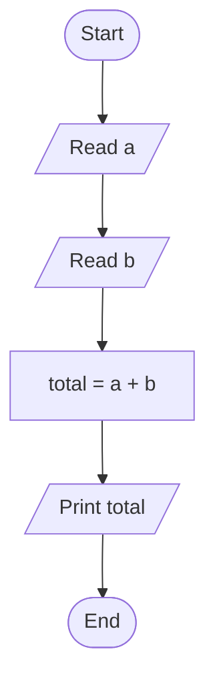
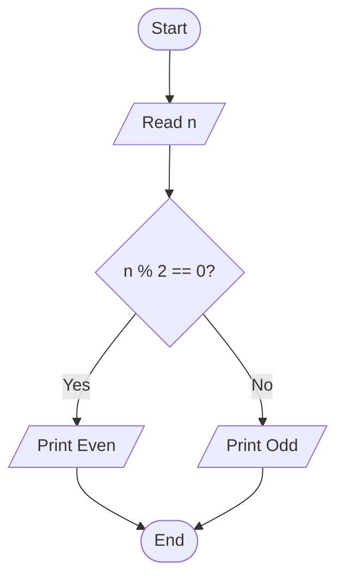
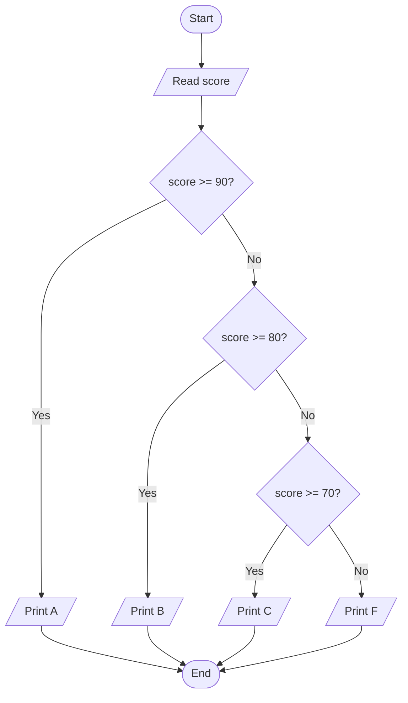
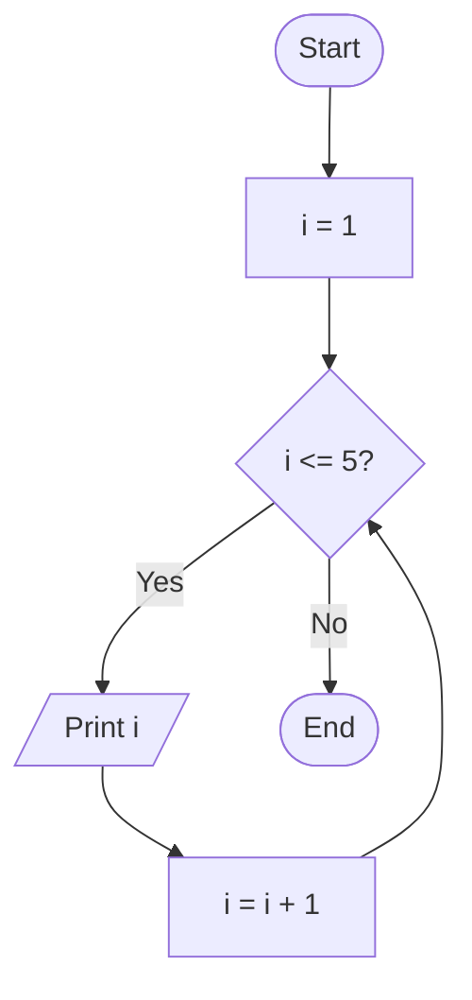
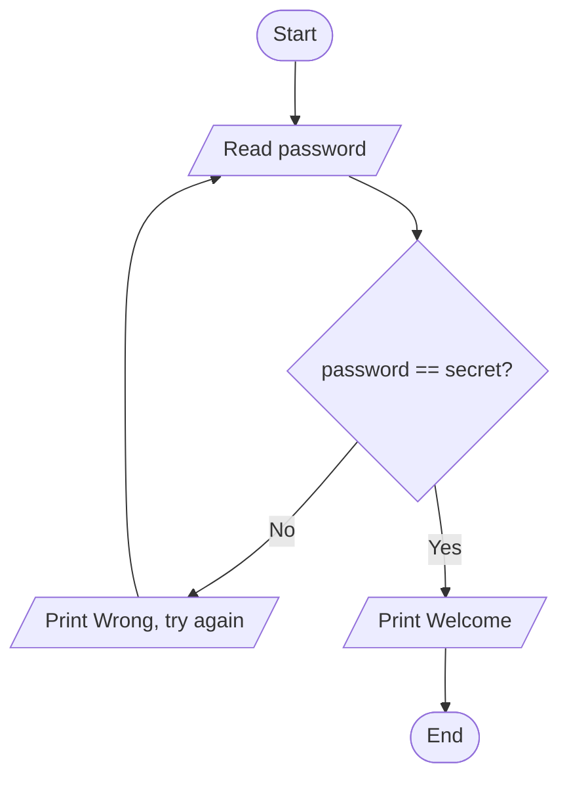
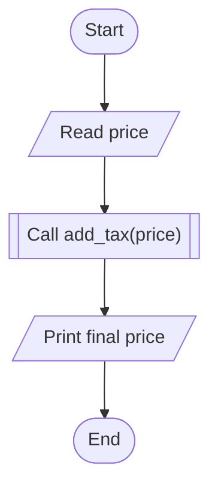
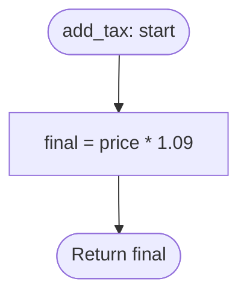
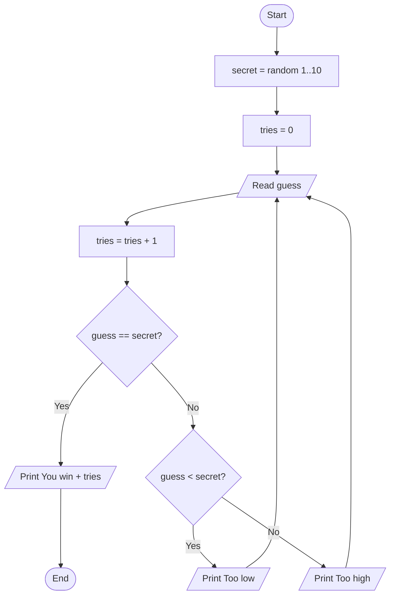
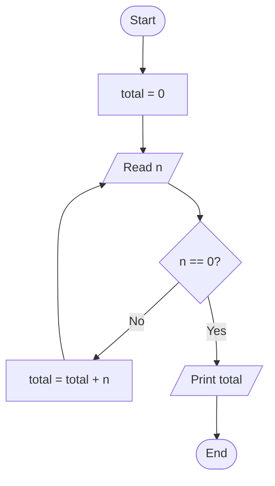

# Flowcharts Made Easy (with Python)

> Learn to think in flowcharts, then turn them into Python code in minutes.

---

## 1. What is a flowchart?

A **flowchart** is a picture of a process: *start here, do this, decide that, end there.*
Programmers draw one **before** writing code, so the logic is clear first and the typing is easy second.

**Golden idea:** every flowchart is built from just **4 building blocks**:

1. Do things in order (**sequence**)
2. Make a choice (**decision**)
3. Repeat (**loop**)
4. Reuse a recipe (**function**)

Master these and you can draw (and code) almost anything.

---

## 2. The symbols you need

| Shape | Name | Meaning | Python equivalent |
|---|---|---|---|
| Rounded box (pill) | **Start / End** | Where the flow begins or finishes | top of script / end of script |
| Rectangle | **Process** | Do an action or calculation | `x = x + 1` |
| Parallelogram | **Input / Output** | Read data or show data | `input()` / `print()` |
| Diamond | **Decision** | Yes/No question | `if` / `while` |
| Arrow | **Flow line** | Which step comes next | next line of code |

**Rules of thumb**

- One **Start**, at least one **End**.
- Flow goes **top → bottom** (or left → right).
- A **diamond** always has **two exits**: `Yes` and `No`.
- Every arrow must lead **somewhere**. No dead ends.
- Keep each box to **one simple action**.

---

## 3. How to draw flowcharts in this document

The diagrams below use **Mermaid**, a text-based diagram language. They render automatically on GitHub, GitLab, Notion, Obsidian, VS Code (with the Markdown Preview Mermaid extension), and most Markdown tools.

Mermaid cheat sheet:

```text
A([Start])        rounded pill  -> Start/End
B[Do something]   rectangle     -> Process
C[/Read input/]   parallelogram -> Input/Output
D{Question?}      diamond       -> Decision
A --> B           arrow
D -->|Yes| E      labeled arrow
```

---

## 4. Block 1: Sequence (step by step)

**Problem:** Ask for two numbers and print their sum.



**Python:**

```python
a = float(input("Enter a: "))
b = float(input("Enter b: "))
total = a + b
print("Sum:", total)
```

**Trick:** each box becomes exactly **one line** of code.

---

## 5. Block 2: Decision (`if / else`)

**Problem:** Check if a number is even or odd.



**Python:**

```python
n = int(input("Enter a number: "))

if n % 2 == 0:
    print("Even")
else:
    print("Odd")
```

**Trick:** a diamond = `if`. The **Yes** branch is the indented block, the **No** branch is `else`.

### Multiple choices (`elif`)

**Problem:** Convert a score to a grade.



**Python:**

```python
score = int(input("Score: "))

if score >= 90:
    print("A")
elif score >= 80:
    print("B")
elif score >= 70:
    print("C")
else:
    print("F")
```

**Trick:** a chain of diamonds, each one on the **No** exit of the previous, becomes `if / elif / else`.

---

## 6. Block 3: Loops (repeat)

A loop in a flowchart is simply **an arrow that goes back up**.

### 6.1 `while` loop (repeat until a condition changes)

**Problem:** Print numbers 1 to 5.



**Python:**

```python
i = 1
while i <= 5:
    print(i)
    i = i + 1
```

**Trick:** the diamond is the `while` condition. The arrow returning to the diamond is the loop.

### 6.2 `for` loop (repeat a known number of times)

The same flowchart can be written shorter:

```python
for i in range(1, 6):
    print(i)
```

Use `for` when you know **how many times**. Use `while` when you repeat **until something happens**.

### 6.3 Loop with a goal: password check

**Problem:** Keep asking until the password is correct.



**Python:**

```python
secret = "python123"
password = input("Password: ")

while password != secret:
    print("Wrong, try again")
    password = input("Password: ")

print("Welcome!")
```

---

## 7. Block 4: Functions (reusable recipes)

When a part of the flowchart appears many times, give it a name and draw it separately.

**Main flow:**



**Inside the function `add_tax`:**



**Python:**

```python
def add_tax(price):
    final = price * 1.09
    return final

price = float(input("Price: "))
print("Final price:", add_tax(price))
```

**Trick:** a rectangle with double side bars (`[[ ]]` in Mermaid) means "run another flowchart here".

---

## 8. The 5-step method: from problem to code

1. **Read the problem** and underline the **inputs** and **outputs**.
2. **Write the steps** in plain words (no code yet).
3. **Find the questions**: every "if", "when", "until", "for each" becomes a diamond.
4. **Draw it**: Start, then boxes and diamonds, then End. Check every arrow.
5. **Translate to Python**: box = line, diamond = `if`/`while`, back arrow = loop.

---

## 9. Full example: Guess the number game

**Problem:** The computer picks a secret number from 1 to 10. The player keeps guessing until correct. Count the attempts.



**Python:**

```python
import random

secret = random.randint(1, 10)
tries = 0

while True:
    guess = int(input("Your guess (1-10): "))
    tries += 1

    if guess == secret:
        print(f"You win! It took {tries} tries.")
        break
    elif guess < secret:
        print("Too low")
    else:
        print("Too high")
```

---

## 10. Bonus: generate a flowchart from Python

You can even draw flowcharts **with Python**, using the `graphviz` library.

```bash
pip install graphviz
# Also install the Graphviz program: https://graphviz.org/download/
```

```python
from graphviz import Digraph

g = Digraph("even_odd", format="png")
g.attr(rankdir="TB")

g.node("start", "Start", shape="oval")
g.node("read", "Read n", shape="parallelogram")
g.node("check", "n % 2 == 0?", shape="diamond")
g.node("even", "Print Even", shape="parallelogram")
g.node("odd", "Print Odd", shape="parallelogram")
g.node("end", "End", shape="oval")

g.edge("start", "read")
g.edge("read", "check")
g.edge("check", "even", label="Yes")
g.edge("check", "odd", label="No")
g.edge("even", "end")
g.edge("odd", "end")

g.render("even_odd", view=True)   # creates even_odd.png
```

---

## 11. Common mistakes

| Mistake | Fix |
|---|---|
| Diamond with only one exit | Always draw both **Yes** and **No** |
| Loop that never ends | Make sure something inside the loop **changes** the condition |
| Too many actions in one box | One box = one action |
| Forgetting Start/End | Every chart needs them |
| Crossing arrows everywhere | Redraw; keep the flow top to bottom |
| Drawing code, not logic | Write boxes in plain language ("Add tax"), not syntax |

---

## 12. Practice exercises

Draw the flowchart first, then write the Python.

1. **Easy:** Read a number and print whether it is positive, negative, or zero.
2. **Easy:** Print the multiplication table of a number (1 to 10).
3. **Medium:** Read numbers until the user types `0`, then print their total.
4. **Medium:** Find the largest of three numbers.
5. **Medium:** Check if a number is prime.
6. **Hard:** ATM: ask for a PIN (3 attempts max), then show a menu (balance / withdraw / exit).

**Solution for exercise 3** (try it yourself first):



```python
total = 0
n = int(input("Number (0 to stop): "))

while n != 0:
    total += n
    n = int(input("Number (0 to stop): "))

print("Total:", total)
```


---

## 13. Quick reference

| Flowchart pattern | Python |
|---|---|
| Boxes in a line | Lines of code in order |
| Diamond, 2 exits | `if ... else` |
| Diamond chain | `if ... elif ... else` |
| Arrow back up to a diamond | `while condition:` |
| Repeat N times | `for i in range(N):` |
| Box with double bars | `def` and function call |
| End box | End of script / `return` |

---

## 14. Summary

- Flowcharts = **Sequence + Decision + Loop + Function**.
- **Diamond = question**, **arrow back = loop**.
- Draw first, code second. The code almost writes itself.
- Start with small problems, then combine blocks for bigger ones.

Happy coding!
