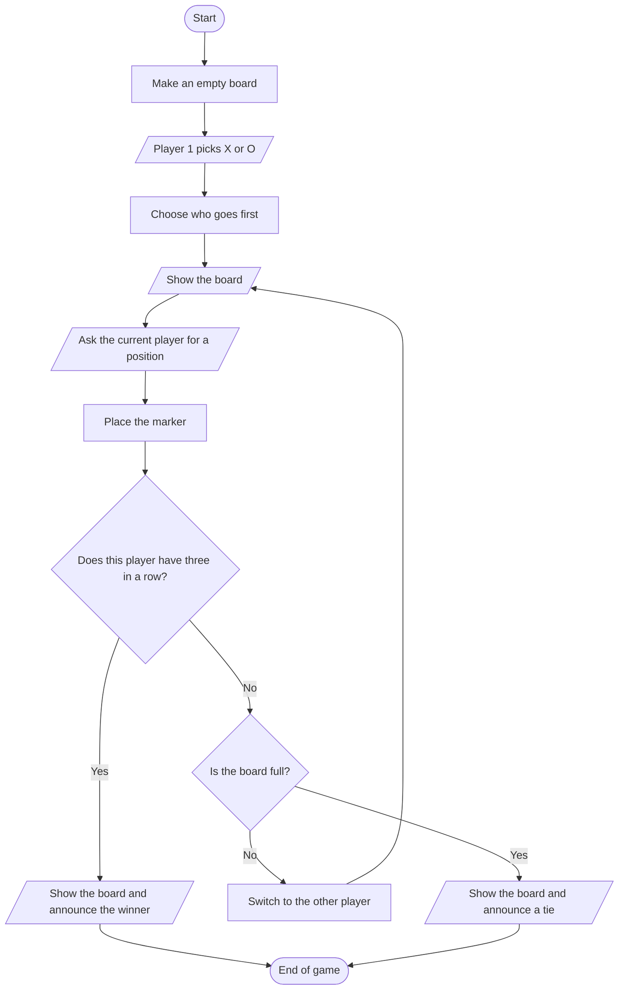

# Milestone Project 1: Tic Tac Toe

> Your first real project. You will build a complete two-player Tic Tac Toe game that runs in the console, one small function at a time, and test each piece before you put them together.

**Level:** Beginner → Intermediate
**Prerequisites:** Modules 1 to 3 (*Objects and Data Structures*, *Statements*, *Methods and Functions*)
**Requirements:** Python 3.10+
**Estimated time:** 4–6 hours

---

## Table of Contents

1. [The Project](#1-the-project)
2. [Plan Before You Code](#2-plan-before-you-code)
3. [Step 1: Show the Board](#3-step-1-show-the-board)
4. [Step 2: Put a Marker on the Board](#4-step-2-put-a-marker-on-the-board)
5. [Step 3: Ask for a Position](#5-step-3-ask-for-a-position)
6. [Step 4: Who Has Won?](#6-step-4-who-has-won)
7. [Step 5: Is the Board Full?](#7-step-5-is-the-board-full)
8. [Step 6: Who Goes First, and Play Again?](#8-step-6-who-goes-first-and-play-again)
9. [Step 7: Put It All Together](#9-step-7-put-it-all-together)
10. [Test, Check, and Go Further](#10-test-check-and-go-further)

> **How to use this module:** this is a *project*, not a lecture. Read the plan, then build the game yourself, one function at a time. Try each step on your own **before** you open the code shown here. When your version works, compare it with ours. A different solution that passes the tests is a good solution.

---

## 1. The Project

### 1.1 Congratulations on making it to your first milestone!

You have already learned a ton and you are ready to work on a real project.

> **Your assignment:** Create a Tic Tac Toe game. You are free to use any IDE you like.
>
> Here are the requirements:
>
> * 2 players should be able to play the game (both sitting at the same computer)
> * The board should be printed out every time a player makes a move
> * You should be able to accept input of the player position and then place a symbol on the board

That is the whole brief. Everything else (how to store the board, which functions to write, what happens when someone types nonsense) is **your design**. This module walks you through one good design.

### 1.2 What the game looks like

Two people share one keyboard. Player 1 picks `X` or `O`. A random player starts. Each player types a number from 1 to 9 to say which square they want, and the board is printed after every move:

```text
 X | O |   
---+---+---
   | X |   
---+---+---
   |   | O 
```

The first player to get three of their symbols in a row (across, down, or diagonally) wins. If all nine squares fill up with no winner, it is a tie. Afterwards the players may start a new game.

The squares are numbered like this, so the number you type is the square you get:

```text
 1 | 2 | 3 
---+---+---
 4 | 5 | 6 
---+---+---
 7 | 8 | 9 
```

### 1.3 Requirements checklist

Keep this table open. You are done when every row is true.

| # | Requirement | Where we build it |
|---|---|---|
| R1 | Two players play at the same computer | Chapters 5 and 9 (turns) |
| R2 | The board is printed after every move | Chapters 3 and 9 |
| R3 | The program accepts a position as input | Chapter 5 |
| R4 | A symbol is placed on the board at that position | Chapter 4 |
| R5 | The game detects a win and a tie | Chapters 6 and 7 |
| R6 | Bad input never crashes the game | Chapter 5 |
| R7 | Players can play again | Chapter 8 |

R1 to R4 are the assignment. R5 to R7 are what turns it into a game people can actually enjoy.

### 1.4 Which skills you will use

| Skill | From module | Used for |
|---|---|---|
| Lists and indexing | 1 | Storing the board |
| Strings and f-strings | 1 | Drawing the board |
| `if` / `elif` / `else` | 2 | Win, tie, and error messages |
| `while` loops | 2 | Asking again until the answer is valid; the game loop |
| `for` loops, `any`, `all` | 2 | Checking the eight winning lines |
| Functions, `return`, docstrings | 3 | Every step of the game |
| `input()` and the `random` module | 1, 3 | Players' moves and who goes first |

### 1.5 Try It
1. Without looking ahead, write on paper **every thing the program must do** from start to finish, as a list of short steps.
2. Which of those steps happen **once**, and which repeat? Mark the repeating ones.
3. Pick the requirement (R1 to R7) you think will be hardest. Why?

---

## 2. Plan Before You Code

### 2.1 Learning goals
- Break a project into small functions that each do **one** job
- Choose a way to store the board
- Draw the main loop of the game as a flowchart
- Decide how you will test each function on its own

### 2.2 Storing the board

The board has nine squares. A **list** with one item per square is the simplest choice. Each item is `"X"`, `"O"`, or `" "` (a space, meaning empty).

We make the list **ten** items long and never use item 0. Then square 1 is `board[1]`, square 9 is `board[9]`, and the number the player types is the index. No `- 1` needed anywhere.

```python
board = [" "] * 10          # index 0 is never used
board[5] = "X"              # the player chose square 5
print(board)
# [' ', ' ', ' ', ' ', ' ', 'X', ' ', ' ', ' ', ' ']
```

> **Design choice.** A list of nine items with `position - 1` everywhere is also fine, and it wastes no space. We pick ten because it removes a whole class of off-by-one mistakes while you are learning. The functions you write hide this choice from the rest of the program, so you can change it later in one place.

### 2.3 One job per function

A good plan lists the functions before writing any of them:

| Function | Job | Returns |
|---|---|---|
| `new_board()` | Make an empty board | the list |
| `display_board(board)` | Print the board | nothing |
| `place_marker(board, marker, position)` | Put a symbol on the board | nothing |
| `space_check(board, position)` | Is this square free? | `True` / `False` |
| `position_error(text, board)` | Why is this input not usable? | a message, or `""` |
| `player_choice_position(board)` | Ask until the answer is valid | the position (1 to 9) |
| `win_check(board, mark)` | Has this player three in a row? | `True` / `False` |
| `full_board_check(board)` | Is every square used? | `True` / `False` |
| `player_choice()` | Player 1 picks X or O | the two markers |
| `choose_first()` | Who starts? | `"Player 1"` / `"Player 2"` |
| `replay()` | Play another game? | `True` / `False` |
| `play_game()` | One whole game | the winner or `None` |

Notice the pattern. Functions that **decide** something (`space_check`, `win_check`, `full_board_check`, `position_error`) only look at their arguments and return an answer. They never print or ask for input. That makes them easy to test. Functions that **talk to the player** (`display_board`, `player_choice_position`, `replay`) are kept small and separate.

### 2.4 The flow of one game

Draw the loop before you code it. This is the heart of the program:



Read it as a recipe. The loop is the arrow from *Switch to the other player* back up to *Show the board*. There are two ways out: a win, or a tie.

### 2.5 How will you know each piece works?

Write a few `assert` statements for each decision function **before** the function itself (this is the habit from Module 3). If an `assert` fails, Python stops and tells you exactly which expectation was wrong. If everything passes, it prints nothing.

```python
assert 1 + 1 == 2          # passes: prints nothing
assert [1, 2, 3][0] == 1   # passes: prints nothing
```

### 2.6 Try It
1. Draw your own version of the flowchart. Does it have the same two exits?
2. What would change in the plan if the board were a list of nine items? Which functions would need to know?
3. Why is it better that `win_check` returns `True` or `False` instead of printing "You win!"?

---

## 3. Step 1: Show the Board

### 3.1 Learning goals
- Build text with f-strings and print it over several lines
- Write a function that takes the board and prints it

### 3.2 A first attempt

The board is a list. We want three rows, with the squares separated by `|` and the rows by a line of dashes:

```python
board = [" ", "X", "O", " ", " ", "X", " ", " ", " ", "O"]

print(f" {board[1]} | {board[2]} | {board[3]} ")
print("---+---+---")
print(f" {board[4]} | {board[5]} | {board[6]} ")
print("---+---+---")
print(f" {board[7]} | {board[8]} | {board[9]} ")
```

Each f-string puts three squares between the bars. The extra spaces keep each symbol centred in its cell.

### 3.3 Turn it into a function

You will print the board many times, so wrap the code in a function:

```python
def display_board(board):
    """Print the board as three rows of three squares."""
    print(f" {board[1]} | {board[2]} | {board[3]} ")
    print("---+---+---")
    print(f" {board[4]} | {board[5]} | {board[6]} ")
    print("---+---+---")
    print(f" {board[7]} | {board[8]} | {board[9]} ")


def new_board():
    """Return an empty board (index 0 is never used)."""
    return [" "] * 10


display_board(new_board())
```

A tidy program also leaves a blank line before the board so moves do not run together. Add `print()` as the first line if you like the look.

### 3.4 Make a board you can look at

While you are building, you will want to see boards in different states. Make them by hand:

```python
def display_board(board):
    """Print the board as three rows of three squares."""
    print(f" {board[1]} | {board[2]} | {board[3]} ")
    print("---+---+---")
    print(f" {board[4]} | {board[5]} | {board[6]} ")
    print("---+---+---")
    print(f" {board[7]} | {board[8]} | {board[9]} ")


test_board = [" ", "X", "O", "X", " ", "O", " ", " ", "X", " "]
display_board(test_board)
```

### 3.5 Common mistakes

| Mistake | What happens | Fix |
|---|---|---|
| Using `board[0]` for the first square | Prints the unused slot; every square is off by one | Squares are `board[1]` to `board[9]` |
| Forgetting the `f` before the quotes | Prints the text `{board[1]}` instead of the symbol | `f"..."` |
| `return`ing the text instead of printing | Nothing appears on screen | `display_board` should `print` |
| Printing the whole list | Shows `[' ', 'X', ...]` | Print three rows |

### 3.6 Try It
1. Change `display_board` so it prints a blank line before the board.
2. Make it print the empty board with the square **numbers** instead of spaces. Where could this help a new player?
3. Write `display_board` using a `for` loop over rows instead of five `print` calls. Is it clearer?

*Check yourself with exercise 1 in the practice cards for this chapter.*

---

## 4. Step 2: Put a Marker on the Board

### 4.1 Learning goals
- Write a function that **changes** a list in place
- Understand why this function returns nothing
- Let Player 1 choose a marker

### 4.2 `place_marker`

Placing a marker is one assignment. Wrapping it in a function gives the step a name and one place to change if the board ever changes:

```python
def place_marker(board, marker, position):
    """Put marker ('X' or 'O') on the board at position (1 to 9)."""
    board[position] = marker


board = [" "] * 10
place_marker(board, "X", 5)
place_marker(board, "O", 1)
print(board)
# [' ', 'O', ' ', ' ', ' ', 'X', ' ', ' ', ' ', ' ']
```

### 4.3 Why does it return nothing?

Lists are **mutable** and a function receives the very same list, not a copy (Module 3, *side effects*). So `place_marker` changes the caller's board directly. There is nothing to return, and writing `board = place_marker(...)` would set `board` to `None`.

```python
def place_marker(board, marker, position):
    board[position] = marker


board = [" "] * 10
result = place_marker(board, "X", 3)
print(result)
print(board[3])
```

This is the same trap as `x = my_list.sort()` from Chapter 1 of Module 3.

### 4.4 Player 1 chooses a marker

The assignment says players place "a symbol". We let Player 1 choose between `X` and `O`, and Player 2 gets the other. The function must keep asking until the answer is valid, so it uses a `while` loop:

```python
def player_choice():
    """Ask Player 1 for X or O; return (player 1 marker, player 2 marker)."""
    marker = ""
    while marker not in ("X", "O"):
        marker = input("Player 1, do you want to be X or O? ").strip().upper()
    if marker == "X":
        return "X", "O"
    return "O", "X"


player1, player2 = player_choice()
print(f"Player 1 is {player1}, Player 2 is {player2}")
```

Two details make it friendly: `.strip()` ignores stray spaces, and `.upper()` accepts a lowercase `x`.

### 4.5 Try It
1. Without running it: what does `place_marker(board, "X", 4)` return? What does `board[4]` hold afterwards?
2. What happens if you call `place_marker(board, "X", 4)` when square 4 already holds `"O"`? Is that a bug in `place_marker`? Who should prevent it?
3. Make `player_choice` also accept the word `"x"` surrounded by spaces. Does it already?
4. Add a third return value: a message such as `"Player 1 is X"`. Should `player_choice` print it, or return it?

---

## 5. Step 3: Ask for a Position

### 5.1 Learning goals
- Check whether a square is free
- Turn text typed by a person into a safe position
- Keep asking until the answer is valid
- Separate **checking** from **asking** so each part can be tested

### 5.2 Is the square free?

An empty square holds a single space:

```python
def space_check(board, position):
    """Return True if the square at position is empty."""
    return board[position] == " "


board = [" "] * 10
board[5] = "X"
print(space_check(board, 5))
print(space_check(board, 6))
```

The function returns a comparison. There is no need for `if ...: return True else: return False`.

### 5.3 What can a person type?

People type anything: `5`, ` 5 `, `five`, `0`, `10`, `-3`, `5.5`, or just press Enter. The program must never crash. Run these through `int()` and see what happens:

```python
for text in ["5", " 5 ", "five", "", "5.5", "-3", "0", "10"]:
    try:
        print(repr(text), "->", int(text))
    except ValueError as error:
        print(repr(text), "-> ValueError:", error)
```

Some become numbers that are **not valid squares** (`0`, `-3`, `10`), and some raise an error. We need a gate that lets through only digits from 1 to 9 on a free square.

### 5.4 A testable checker

Instead of mixing the questions with the checking, write a function that takes the text and the board and returns **why** it is not usable. It returns an empty string when the input is fine:

```python
def space_check(board, position):
    return board[position] == " "


def position_error(text, board):
    """Return a message explaining why text is not a usable position, or '' if it is."""
    text = text.strip()
    if not text.isdecimal():
        return "Please type a number from 1 to 9."
    position = int(text)
    if not 1 <= position <= 9:
        return "The number must be from 1 to 9."
    if not space_check(board, position):
        return "That square is already taken."
    return ""


board = [" "] * 10
board[5] = "X"
for text in ["3", " 7 ", "five", "", "5.5", "-3", "0", "10", "5"]:
    print(repr(text), "->", repr(position_error(text, board)))
```

Because `position_error` neither prints nor asks, you can test it with plain `assert` lines:

```python
def space_check(board, position):
    return board[position] == " "


def position_error(text, board):
    text = text.strip()
    if not text.isdecimal():
        return "Please type a number from 1 to 9."
    position = int(text)
    if not 1 <= position <= 9:
        return "The number must be from 1 to 9."
    if not space_check(board, position):
        return "That square is already taken."
    return ""


board = [" "] * 10
board[5] = "X"
assert position_error("3", board) == ""
assert position_error("5", board) == "That square is already taken."
assert position_error("10", board) == "The number must be from 1 to 9."
assert position_error("abc", board) == "Please type a number from 1 to 9."
```

Silence means every `assert` passed.

### 5.5 Keep asking

Now the asking function is short. It repeats until the checker says the input is fine:

```python
def space_check(board, position):
    return board[position] == " "


def position_error(text, board):
    text = text.strip()
    if not text.isdecimal():
        return "Please type a number from 1 to 9."
    position = int(text)
    if not 1 <= position <= 9:
        return "The number must be from 1 to 9."
    if not space_check(board, position):
        return "That square is already taken."
    return ""


def player_choice_position(board):
    """Ask until the player types a free square (1 to 9); return it as an int."""
    while True:
        text = input("Choose a position (1-9): ")
        problem = position_error(text, board)
        if problem == "":
            return int(text)
        print(problem)


board = [" "] * 10
board[5] = "X"
position = player_choice_position(board)
print("You chose", position)
```

Read the loop slowly: it keeps going, and the **only** way out is the `return` on valid input. This is the same pattern as *Loop until the answer is right* from the flowchart primer.

### 5.6 Common mistakes

| Mistake | What happens | Fix |
|---|---|---|
| `int(input(...))` directly | Typing `five` crashes with `ValueError` | Check the text first, or use `try`/`except` |
| Only checking `1 <= n <= 9` | Typing a taken square overwrites it | Also call `space_check` |
| Using `isdigit()` for numbers like `²` | Passes the check but `int("²")` fails | `isdecimal()` matches what `int()` accepts |
| Returning the **text** from the loop | Later `board["5"]` raises `TypeError` | `return int(text)` |
| Putting `print` and `input` inside the checker | Cannot be tested with `assert` | Keep checking and asking apart |

### 5.7 Try It
1. Without running it: what does `position_error("  4  ", board)` return on an empty board?
2. Add a rule: reject squares for which `board[position]` is not `" "` **and** print which marker is already there.
3. Use `try`/`except ValueError` instead of `isdecimal()`. Which version is easier to read? Does it still reject `"-3"` and `"10"`?
4. Why does `player_choice_position` convert to `int` only at the end?

---

## 6. Step 4: Who Has Won?

### 6.1 Learning goals
- Describe the eight winning lines as data
- Write a function that answers a yes/no question
- Use `any` and `all` to check many cases with one expression

### 6.2 The eight winning lines

There are three rows, three columns, and two diagonals. With our numbering:

| Lines | Squares |
|---|---|
| Rows | 1-2-3, 4-5-6, 7-8-9 |
| Columns | 1-4-7, 2-5-8, 3-6-9 |
| Diagonals | 1-5-9, 3-5-7 |

Store them once, as data:

```python
WIN_LINES = [
    (1, 2, 3), (4, 5, 6), (7, 8, 9),   # rows
    (1, 4, 7), (2, 5, 8), (3, 6, 9),   # columns
    (1, 5, 9), (3, 5, 7),              # diagonals
]
print(len(WIN_LINES))
```

### 6.3 A beginner version

A direct but long version checks each line by hand:

```python
def win_check(board, mark):
    """Return True if mark has three in a row."""
    return (
        (board[1] == mark and board[2] == mark and board[3] == mark) or
        (board[4] == mark and board[5] == mark and board[6] == mark) or
        (board[7] == mark and board[8] == mark and board[9] == mark) or
        (board[1] == mark and board[4] == mark and board[7] == mark) or
        (board[2] == mark and board[5] == mark and board[8] == mark) or
        (board[3] == mark and board[6] == mark and board[9] == mark) or
        (board[1] == mark and board[5] == mark and board[9] == mark) or
        (board[3] == mark and board[5] == mark and board[7] == mark)
    )


board = ["#", "X", "X", "X", " ", " ", " ", " ", " ", " "]
print(win_check(board, "X"))
print(win_check(board, "O"))
```

It works, and one typo in any of the 24 index numbers breaks it silently.

### 6.4 A shorter version with data

Because the lines are data, a loop can check them all. `all(...)` is true when every item is true, and `any(...)` is true when at least one is:

```python
WIN_LINES = [
    (1, 2, 3), (4, 5, 6), (7, 8, 9),
    (1, 4, 7), (2, 5, 8), (3, 6, 9),
    (1, 5, 9), (3, 5, 7),
]


def win_check(board, mark):
    """Return True if mark fills any of the eight winning lines."""
    return any(all(board[i] == mark for i in line) for line in WIN_LINES)


board = ["#", "X", "X", "X", " ", " ", " ", " ", " ", " "]
print(win_check(board, "X"))
print(win_check(board, "O"))
```

Read it from the inside out: for a line, are **all** three squares equal to `mark`? Is that true for **any** line?

### 6.5 Test it properly

A function that decides the winner deserves real tests. Check every line, plus the cases that must **not** win:

```python
WIN_LINES = [
    (1, 2, 3), (4, 5, 6), (7, 8, 9),
    (1, 4, 7), (2, 5, 8), (3, 6, 9),
    (1, 5, 9), (3, 5, 7),
]


def win_check(board, mark):
    return any(all(board[i] == mark for i in line) for line in WIN_LINES)


for line in WIN_LINES:
    board = [" "] * 10
    for i in line:
        board[i] = "O"
    assert win_check(board, "O"), line
    assert not win_check(board, "X"), line

# two in a row is not a win
board = [" "] * 10
board[1] = board[2] = "X"
assert not win_check(board, "X")

print("all win tests passed")
```

One more experiment shows why `win_check` must only ever be called with `"X"` or `"O"`:

```python
WIN_LINES = [
    (1, 2, 3), (4, 5, 6), (7, 8, 9),
    (1, 4, 7), (2, 5, 8), (3, 6, 9),
    (1, 5, 9), (3, 5, 7),
]


def win_check(board, mark):
    return any(all(board[i] == mark for i in line) for line in WIN_LINES)


print(win_check([" "] * 10, " "))
```

It prints `True`: three empty squares "match" the empty mark. The game loop never does this, because it only passes the marker of the player who just moved.

### 6.6 Common mistakes

| Mistake | What happens | Fix |
|---|---|---|
| Missing a diagonal | The game never ends when someone wins that way | Check all **eight** lines; test each one |
| Checking only the **last** move's player | Fine, and faster | Call `win_check` for the player who just moved |
| Checking for `" "` as a mark | Three empty squares count as a "win" | Only pass `"X"` or `"O"` |
| Printing "You win" inside `win_check` | Cannot reuse or test it | Return `True`/`False`; print in the game loop |

### 6.7 Try It
1. Which squares does the diagonal from the top-right corner use? Is it in `WIN_LINES`?
2. Write the board for a win in the middle column, then predict `win_check(board, "O")` before running it.
3. Why is checking only the player who just moved enough? Could the **other** player win by a move they did not make?
4. Write `win_check` with an ordinary `for` loop and a flag variable instead of `any`/`all`.

---

## 7. Step 5: Is the Board Full?

### 7.1 Learning goals
- Detect a tie
- Search the board without using index 0

### 7.2 `full_board_check`

If no square is empty and nobody has won, the game is a tie. A square is empty when it holds a space, so the board is full when **no** space remains in squares 1 to 9:

```python
def full_board_check(board):
    """Return True if no empty square is left (index 0 is ignored)."""
    return " " not in board[1:]


board = ["#", "X", "O", "X", "O", "X", "O", "O", "X", "O"]
print(full_board_check(board))
board[5] = " "
print(full_board_check(board))
```

`board[1:]` is a slice that skips the unused slot 0. If your unused slot holds a space (as ours does in `new_board()`), forgetting the slice would make the board **never** full.

### 7.3 A tie, in the right order

In the game loop the order of the two checks matters. Suppose the last square is filled **and** it completes three in a row. That is a win, not a tie. So: check for a win first, and for a full board second.

```python
WIN_LINES = [
    (1, 2, 3), (4, 5, 6), (7, 8, 9),
    (1, 4, 7), (2, 5, 8), (3, 6, 9),
    (1, 5, 9), (3, 5, 7),
]


def win_check(board, mark):
    return any(all(board[i] == mark for i in line) for line in WIN_LINES)


def full_board_check(board):
    return " " not in board[1:]


# the ninth move wins the game for X on the diagonal 3-5-7
board = ["#", "O", "X", "X", "X", "X", "O", "X", "O", "O"]
print("X wins:", win_check(board, "X"))
print("full  :", full_board_check(board))
```

Both are `True`. If the loop announced "tie" first, X would lose a game they had won.

### 7.4 Common mistakes

| Mistake | What happens | Fix |
|---|---|---|
| `" " not in board` | Never full, because index 0 holds a space | `board[1:]` |
| Checking for a tie before a win | The last move can win and still be called a tie | Win first |
| Counting `board.count(" ") == 0` | Same index-0 problem | `board[1:].count(" ") == 0` |

### 7.5 Try It
1. Without running it: what does `full_board_check(new_board())` return?
2. Give a different way to write `full_board_check` using `all(...)` and a comparison.
3. A full board with a winner and a full board with no winner both return `True` from `full_board_check`. Which function tells them apart?

---

## 8. Step 6: Who Goes First, and Play Again?

### 8.1 Learning goals
- Make a random choice
- Ask a yes/no question and handle sloppy answers

### 8.2 `choose_first`

The `random` module has a function that picks one item from a list:

```python
import random


def choose_first():
    """Randomly pick who starts: 'Player 1' or 'Player 2'."""
    return random.choice(["Player 1", "Player 2"])


print(choose_first() in ("Player 1", "Player 2"))
```

A random result cannot be tested for an exact answer. You can test what is **always** true: it is one of the two names.

### 8.3 `replay`

After a game, ask whether to play again. Accept `y`, `Y`, `yes`, and `YES`. Treat everything else as a no:

```python
def replay():
    """Ask whether to play again; return True for any answer that starts with y."""
    return input("Play again? (y/n) ").strip().lower().startswith("y")


print(replay())
```

`startswith("y")` is forgiving: `y`, `yes`, and `Yeah` all work. You could instead insist on exactly `y` or `n` and ask again for anything else, the way `player_choice` does.

### 8.4 Try It
1. Why does `replay` return a **bool** instead of printing something?
2. Rewrite `replay` so it keeps asking until the answer is exactly `y` or `n` (any case).
3. How could you make `choose_first` give a predictable result while you test the game?

---

## 9. Step 7: Put It All Together

### 9.1 Learning goals
- Combine the functions into a game loop
- Switch turns
- Announce a winner or a tie
- Run the whole program

### 9.2 One game

`play_game` follows the flowchart from Chapter 2. A dictionary links each player's name to their marker, and a `while True` loop runs the turns:

```python
def play_game():
    """Play one game; return the winner's name, or None for a tie."""
    board = new_board()
    player1, player2 = player_choice()
    markers = {"Player 1": player1, "Player 2": player2}
    turn = choose_first()
    print(f"{turn} goes first.")

    while True:
        marker = markers[turn]
        display_board(board)
        print(f"{turn} ({marker}), it is your turn.")
        position = player_choice_position(board)
        place_marker(board, marker, position)

        if win_check(board, marker):
            display_board(board)
            print(f"{turn} has won!")
            return turn
        if full_board_check(board):
            display_board(board)
            print("It's a tie!")
            return None

        turn = "Player 2" if turn == "Player 1" else "Player 1"
```

Walk through it:
1. **Setup:** a fresh board, markers, and the starting player.
2. **Show and ask:** print the board, then ask the current player for a free square.
3. **Place:** write the marker on the board.
4. **Decide:** win first, then tie, and `return` ends the game in both cases.
5. **Switch:** otherwise it is the other player's turn and the loop repeats.

Notice that the loop has **no counter**. It ends because a `return` runs, which can only happen after a win or a full board.

### 9.3 The program

`main` plays games until the players have had enough:

```python
def main():
    """Welcome the players and keep playing until they decline a replay."""
    print("Welcome to Tic Tac Toe!")
    while True:
        play_game()
        if not replay():
            break
    print("Thanks for playing!")
```

### 9.4 The whole thing in one piece

Here is the complete program. It asks the players questions as it runs, so type each answer when it asks. For a quick test, answer `X`, then `1`, `4`, `2`, `5`, `3` (try a mistake such as `abc` in between), then `n`.

```python
import random

WIN_LINES = [
    (1, 2, 3), (4, 5, 6), (7, 8, 9),   # rows
    (1, 4, 7), (2, 5, 8), (3, 6, 9),   # columns
    (1, 5, 9), (3, 5, 7),              # diagonals
]


def new_board():
    """Return an empty board (index 0 is never used)."""
    return [" "] * 10


def display_board(board):
    """Print the board as three rows of three squares."""
    print()
    print(f" {board[1]} | {board[2]} | {board[3]} ")
    print("---+---+---")
    print(f" {board[4]} | {board[5]} | {board[6]} ")
    print("---+---+---")
    print(f" {board[7]} | {board[8]} | {board[9]} ")
    print()


def player_choice():
    """Ask Player 1 for X or O; return (player 1 marker, player 2 marker)."""
    marker = ""
    while marker not in ("X", "O"):
        marker = input("Player 1, do you want to be X or O? ").strip().upper()
    return ("X", "O") if marker == "X" else ("O", "X")


def place_marker(board, marker, position):
    """Put marker on the board at position (1 to 9)."""
    board[position] = marker


def space_check(board, position):
    """Return True if the square at position is empty."""
    return board[position] == " "


def position_error(text, board):
    """Return why text is not a usable position, or '' if it is."""
    text = text.strip()
    if not text.isdecimal():
        return "Please type a number from 1 to 9."
    position = int(text)
    if not 1 <= position <= 9:
        return "The number must be from 1 to 9."
    if not space_check(board, position):
        return "That square is already taken."
    return ""


def player_choice_position(board):
    """Ask until the player types a free square (1 to 9); return it as an int."""
    while True:
        text = input("Choose a position (1-9): ")
        problem = position_error(text, board)
        if problem == "":
            return int(text)
        print(problem)


def win_check(board, mark):
    """Return True if mark fills any of the eight winning lines."""
    return any(all(board[i] == mark for i in line) for line in WIN_LINES)


def full_board_check(board):
    """Return True if no empty square is left."""
    return " " not in board[1:]


def choose_first():
    """Randomly pick who starts."""
    return random.choice(["Player 1", "Player 2"])


def replay():
    """Ask whether to play again."""
    return input("Play again? (y/n) ").strip().lower().startswith("y")


def play_game():
    """Play one game; return the winner's name, or None for a tie."""
    board = new_board()
    player1, player2 = player_choice()
    markers = {"Player 1": player1, "Player 2": player2}
    turn = choose_first()
    print(f"{turn} goes first.")

    while True:
        marker = markers[turn]
        display_board(board)
        print(f"{turn} ({marker}), it is your turn.")
        position = player_choice_position(board)
        place_marker(board, marker, position)

        if win_check(board, marker):
            display_board(board)
            print(f"{turn} has won!")
            return turn
        if full_board_check(board):
            display_board(board)
            print("It's a tie!")
            return None

        turn = "Player 2" if turn == "Player 1" else "Player 1"


def main():
    """Welcome the players and keep playing until they decline a replay."""
    print("Welcome to Tic Tac Toe!")
    while True:
        play_game()
        if not replay():
            break
    print("Thanks for playing!")


main()
```

The starting player is random, so the first mover's name changes from run to run. The first mover wins with those answers, because the moves `1, 4, 2, 5, 3` alternate between the two players and give the first mover squares 1, 2 and 3.

### 9.5 Try It
1. Run the program and play a full game with a friend. Which requirement (R1 to R7) did you see working?
2. Without running it: what does `play_game()` return after a tie? What does `main` do with the return value? Is that a problem?
3. Print a message such as `Move 3 of 9` before each turn. What new variable do you need, and where does it live?
4. The game loop has a `while True`. Can you find a version that uses a `while` condition instead? What would you gain or lose?

---

## 10. Test, Check, and Go Further

### 10.1 Learning goals
- Test a function that calls `input()`
- Check the finished game against the requirements
- Pick a stretch goal

### 10.2 Test a function that calls `input()`

You cannot type during an automatic test. Instead, **replace** `input` with a fake that returns prepared answers one by one. This works because names are looked up in the order *Local, Enclosing, Global, Built-in* (Module 3, Chapter 4): a global called `input` is found **before** the built-in one.

```python
def fake_input(answers):
    """Return a function that hands out answers one at a time."""
    answers = iter(answers)
    return lambda prompt="": next(answers)


def player_choice():
    marker = ""
    while marker not in ("X", "O"):
        marker = input("Player 1, do you want to be X or O? ").strip().upper()
    return ("X", "O") if marker == "X" else ("O", "X")


input = fake_input(["z", "", " o "])     # two bad answers, then a good one
assert player_choice() == ("O", "X")

input = fake_input(["x"])
assert player_choice() == ("X", "O")
print("input tests passed")
```

> **Shadowing on purpose.** Replacing a built-in name is normally a mistake (Module 3, Chapter 4). Here it is a deliberate testing trick, and it only affects this script.

### 10.3 Check the finished game against the brief

Go back to the requirements table in Chapter 1 and **prove** each row. Do not just believe it:

| # | Requirement | How to check |
|---|---|---|
| R1 | Two players, same computer | Play a full game with a friend |
| R2 | Board printed after every move | Count the boards on screen: one per move, plus one at the end |
| R3 | Input of the position | Type each of 1 to 9 in a game |
| R4 | Symbol placed on the board | Does the symbol appear exactly where you typed? |
| R5 | Win and tie detected | Play out a win in each of the 8 lines, and one tie |
| R6 | Bad input never crashes | Type `0`, `10`, `-1`, `abc`, nothing, and a taken square |
| R7 | Play again | Answer `y`, then `n` |

### 10.4 Debugging checklist

| Symptom | Likely cause |
|---|---|
| Symbols appear one square off | A function uses `board[position - 1]` while another uses `board[position]` |
| Game never ends | `win_check` misses a line, or the turn is never switched |
| "Tie" announced on a winning last move | Tie checked before the win |
| Crash on typing letters | `int()` called before checking the text |
| Same player moves twice | The turn switch is inside an `if` that is sometimes skipped |
| Board never full | `" " not in board` (index 0 holds a space) |

### 10.5 Stretch goals

Pick one when the basic game works. Keep the old version in a separate file.

1. **Scoreboard.** Count wins for each player across replays and show it after each game.
2. **Player names.** Ask for both names instead of "Player 1" and "Player 2".
3. **A computer player.** Write `computer_move(board, marker)` that picks a random free square, then one that wins when it can and blocks when it must.
4. **Show the guide.** Print the numbered board at the start of each game.
5. **Nicer board.** Use `"·"` for empty squares and `X` / `O` in colour (look up ANSI escape codes).
6. **Bigger board.** Make the board size a variable. Which functions need to change, and which do not?
7. **Tests.** Write a test for `display_board` by capturing its output with `io.StringIO` and `contextlib.redirect_stdout`.

### 10.6 What you practised

A project is the same skills as the lessons, used together: **break the problem down**, write small functions that each do one job, keep decisions apart from input and output, test each piece, then combine them. That plan works for programs of any size.

The next module is **Iterators and Generators**. The game loop you wrote is already an iterator in disguise: you will see how Python's `for` loop works underneath.

### 10.7 Try It
1. Run through the table in 10.3 and tick every row. Which one was hardest to prove?
2. Pick one stretch goal. Write the **plan** (functions and flowchart) before writing code.
3. Give your game to someone who has never seen it and watch them play without helping. What confused them?

---

*End of the project.*
